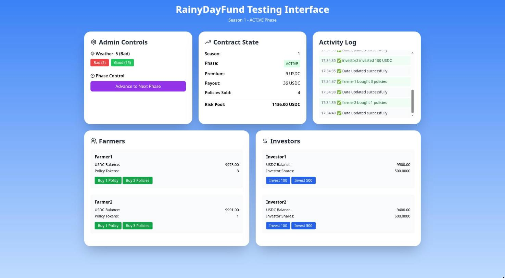

# Decentralized Weather Insurance

Group project (09/2025): EVM-based smart contract with react app for the blockchain challenge @University of Basel.

## Needed installations (not covered here)

- hardhat, node.js

## Quick startup guide

If this is your first run, go into /client and run `npm install`. Then do the same in the /contract folder. This will install all of the used dependencies.

**OPTION 1 (manual):**  
  - Navigate into /contract and run `npx hardhat node` to start your local blockchain.
  - In a new terminal, go into /contract again and run `npx hardhat run /scripts/deploy-for-testing.js --network localhost`. This deploys the contracts onto your local chain.
  - Copy the file `deployment-info.json` into /client/public.
  - Go to the /client folder and run `npm start`. This will launch the frontend at port 3000.

**OPTION 2 (automatic):**  
  - In the project root, run `node start.js` and watch!  

**In both cases,** go to the project root and run `node cleanup.js` to remove old files after running the program. Optionally, run `npx hardhat clean` in the contract folder to be extra sure.

## Known limitation

The risk pool is an ERC-4626 vault whose `totalAssets()` is the contract's USDC balance. If policies are sold before anyone has invested, the premiums land in a vault with zero shares, which distorts the share price for the first investor and leaves payouts uncovered. In the demo, invest into the risk pool before buying policies. A production version would require a minimum pool size (or virtual shares) before policy sales open; see the research paper for details.

https://github.com/user-attachments/assets/f12aa07f-a861-4744-ab3f-5aa6d95f8485